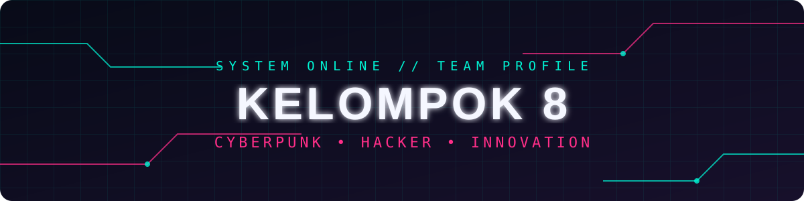
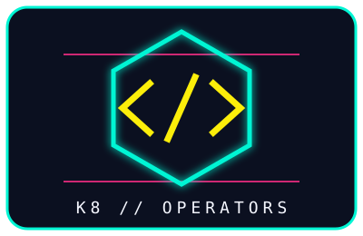
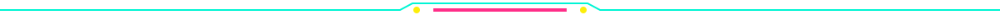
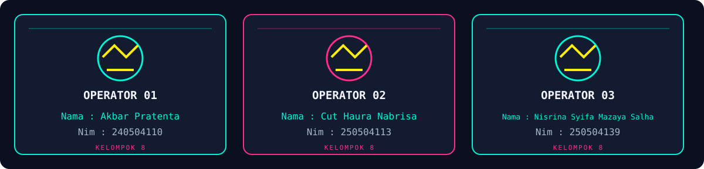
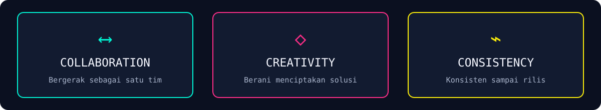
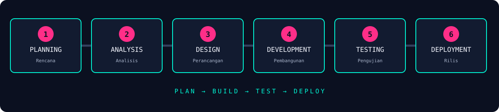
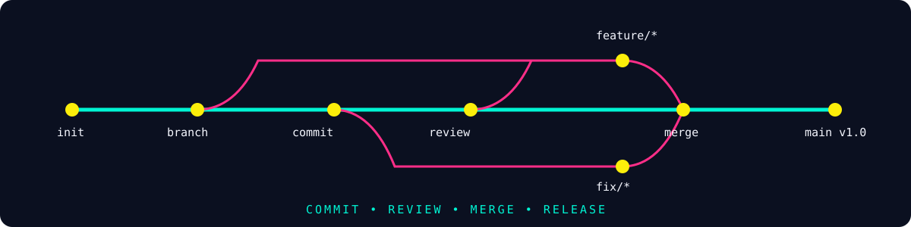
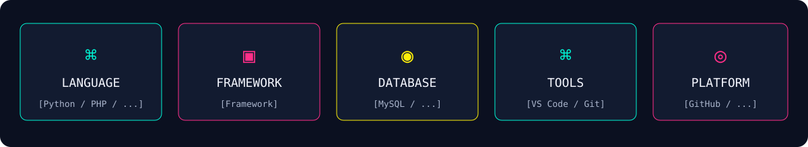
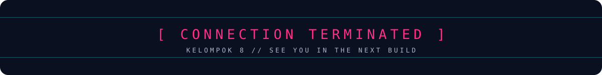

 

### `ACCESS GRANTED` — *"Think beyond limits. Build beyond expectations."*

## ◈ OPERATOR SELECT

> Nama : Akbar Pratenta Nim : 240504110 || Nama : Cut Haura Nabrisa Nim : 250504113 || Nama : Nisrina Syifa Mazaya Salha Nim : 250504139

## ◈ TEAM PROTOCOLS

## ◈ DEVELOPMENT ROADMAP

Setiap proyek melewati enam tahap pengembangan perangkat lunak (SDLC).

## ◈ GIT OPERATIONS

Tiga operator, branch kerja sesuai pembagian tugas, satu tujuan: integrasi ke `main` dan rilis versi `1.0`.

> **Catatan:** sesuaikan nama branch dan jumlah operator dengan workflow Git kelompokmu.

## ◈ SYSTEM LOADOUT

> Isi daftar teknologi di `tech.svg` sesuai tools, bahasa pemrograman, framework, database, dan platform yang benar-benar digunakan.

## ◈ MISSION BRIEF

**Kelompok 8** adalah tim yang berkolaborasi untuk menyelesaikan misi pengembangan perangkat lunak. Kami menggabungkan ide, kemampuan teknis, dan komunikasi agar setiap proses berjalan terarah.

Fokus utama kami adalah memahami kebutuhan, merancang solusi, membangun sistem, melakukan pengujian, dan menyempurnakan hasil. Setiap anggota memiliki peran, tetapi keberhasilan proyek adalah tanggung jawab bersama.

  

## ◈ ACTIVE QUESTS

| Quest | Deskripsi | Status | Link |
|:---|:---|:---:|:---:|
| Nama Proyek | Tulis ringkasan singkat proyek kelompok | `PLANNING` | [Buka](./00-Dokumentasi/spesifikasi-proyek.md) |
| Dokumentasi | Catatan proses, rancangan, dan hasil | `IN PROGRESS` | [Buka](./00-Dokumentasi/) |
| Source Code | Implementasi aplikasi | `IN PROGRESS` | [Buka](./src/) |

---

`END OF TRANSMISSION` · **KELOMPOK 8** · `2026`

